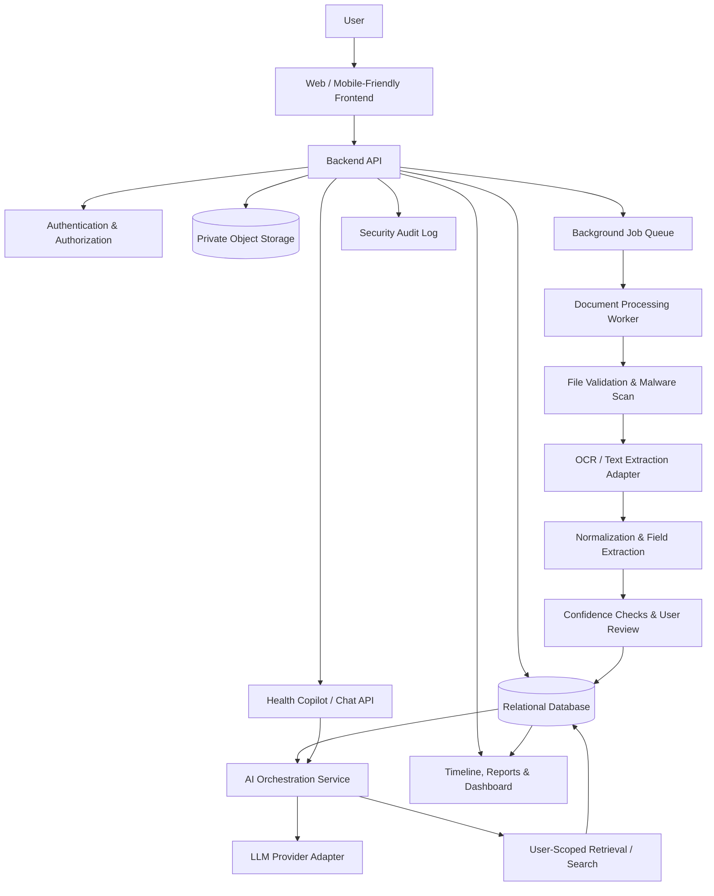

# System Architecture — AI-Powered Personal Health Copilot
**Organization:** Altrix Labs  
**Purpose:** Implementation blueprint for Antigravity  
**Document status:** Initial architecture proposal

## 1. Product Overview

Build a secure AI-powered application that helps people upload, organize, understand, and track personal healthcare information. The system processes medical records, prescriptions, diagnostic reports, and wellness data; extracts structured information; explains it in plain language; and helps users prepare questions for qualified healthcare professionals.

The application is an informational support tool. It must not diagnose conditions, prescribe or change medication, replace a clinician, or present uncertain AI output as established medical fact.

## 2. Architecture Principles

1. **Privacy first:** Health documents and extracted data are private to the authenticated owner by default.
2. **Human-readable, traceable AI:** Show source document/page or text evidence for extracted facts whenever possible.
3. **Human confirmation:** Let users correct OCR results and confirm important extracted information.
4. **Modular design:** Keep UI, API, document processing, AI orchestration, and persistence separate.
5. **Asynchronous processing:** Large uploads and OCR/AI jobs should run as background jobs with visible status.
6. **Safe failure:** If extraction or AI confidence is low, say so and request confirmation instead of guessing.
7. **Replaceable providers:** Put OCR and LLM providers behind adapters so the team can change vendors without rewriting business logic.
8. **MVP-first:** Build a reliable document-to-summary flow before adding advanced integrations.

## 3. High-Level Architecture



### Main components

- **Frontend:** Upload center, document library, processing status, review/edit screen, health timeline, chat/copilot, reminders, settings, and consent controls.
- **Backend API:** Validates requests, checks access, coordinates workflows, and returns safe, structured responses.
- **Authentication and authorization:** Handles sign-in, session/token validation, ownership checks, and role boundaries.
- **Private object storage:** Stores original files and, if required, derived previews. Files must not be publicly accessible.
- **Relational database:** Stores users, document metadata, extracted health facts, summaries, conversations, reminders, and audit events.
- **Job queue and worker:** Runs OCR and extraction tasks outside the request/response cycle.
- **OCR adapter:** Converts PDF/image content into text with page/position information where available.
- **Normalization and extraction:** Maps extracted content to typed fields such as test name, value, unit, reference range, date, medication name, dosage text, and source location.
- **AI orchestration:** Builds constrained prompts, retrieves only the current user's authorized records, calls the model, validates output, and applies safety rules.
- **Audit logging:** Records security-relevant events without unnecessarily copying sensitive document contents into logs.

## 4. Suggested Technology Stack

Use the following as a practical default. Keep each choice configurable in the project.

| Layer | Suggested option | Notes |
|---|---|---|
| Frontend | React + TypeScript + Vite | Responsive web application |
| UI styling | Tailwind CSS or existing project UI system | Choose one and remain consistent |
| Backend | Python + FastAPI | API, validation, document and AI workflows |
| API contracts | OpenAPI / Pydantic schemas | Keep frontend/backend types aligned |
| Database | PostgreSQL | Users, metadata, structured facts, audit records |
| ORM/migrations | SQLAlchemy + Alembic | Schema evolution |
| File storage | S3-compatible private storage; local private storage for development | Never expose bucket/object paths publicly |
| Background jobs | Redis + Celery/RQ, or a managed queue | Retryable document processing |
| OCR | Tesseract for a local baseline; provider adapter for a stronger OCR service if needed | Evaluate accuracy on sample medical documents |
| AI/LLM | Provider-neutral LLM adapter | Select a provider based on privacy, cost, latency, and evaluation |
| Retrieval | PostgreSQL full-text search initially; pgvector only if semantic retrieval is needed | Always enforce user-level access filters |
| Testing | Pytest; frontend test runner; API integration tests | Include security and failure cases |
| Deployment | Docker; managed app/database/storage where available | Keep secrets in environment/secret manager |

**Important:** These are proposed defaults, not fixed requirements. Check current provider terms, data-processing arrangements, costs, regional availability, and applicable health-data/privacy rules before sending real health information to external services.

## 5. Core User Flows

### 5.1 Upload and process a document

1. User signs in and selects a PDF, JPEG, or PNG.
2. API checks file size, MIME type, extension, quota, and ownership context.
3. File is stored in private object storage with a random internal identifier.
4. A `document_processing` job is placed on the queue.
5. Worker validates the file and performs OCR/text extraction.
6. Extraction logic identifies candidate fields and records source page/text evidence and confidence where available.
7. Rules validate dates, units, numeric values, and required fields; uncertain values are flagged.
8. The document status becomes `needs_review` or `processed`.
9. User reviews and corrects extracted fields.
10. Confirmed facts are saved and become available to the health timeline and copilot.

Suggested statuses: `uploaded`, `queued`, `processing`, `needs_review`, `processed`, `failed`, `deleted`.

### 5.2 Ask the Health Copilot

1. User submits a question.
2. API authenticates the user and checks permissions.
3. Retrieval searches only that user's documents and confirmed health facts.
4. The AI orchestrator creates a bounded context containing relevant source snippets and dates.
5. Model returns a structured answer with a plain-language explanation, supporting sources, uncertainty notes, and an appropriate safety message.
6. Backend validates the output schema and source references.
7. UI displays the answer and links to the underlying record when available.
8. The interaction is stored according to the product's retention and privacy settings.

If there is not enough evidence, the copilot must say it cannot determine the answer from the available records. It must not fabricate lab values, diagnoses, citations, or medication instructions.

### 5.3 Health timeline and report comparison

1. Read confirmed, structured facts from the database.
2. Normalize units only when the conversion is well-defined and preserve the original value.
3. Group results by test/measurement and date.
4. Show trends with date, value, unit, reference range when supplied, and source document.
5. Mark incomparable units, missing reference ranges, or uncertain dates instead of silently merging them.

### 5.4 Reminders

1. User creates a reminder or follow-up task.
2. Backend stores schedule, timezone, consent, and delivery preference.
3. A scheduled worker dispatches notifications through a configured provider.
4. User can edit, pause, or delete reminders and opt out of notifications.

Do not infer that a medication should be started, stopped, or changed. Medication reminders should reflect user-confirmed instructions.

## 6. Logical Modules and Responsibilities

```text
frontend/
  src/
    app/                 # routes, app shell, global providers
    components/          # shared UI
    features/
      auth/
      documents/
      extraction-review/
      health-timeline/
      copilot/
      reminders/
      settings-privacy/
    lib/                 # API client, validation helpers
    types/

backend/
  app/
    main.py
    api/
      routes/             # versioned HTTP endpoints
      dependencies.py     # auth, database, permissions
    core/
      config.py           # environment-based settings
      security.py
      logging.py
    models/               # database models
    schemas/              # request/response contracts
    services/
      document_service.py
      storage_service.py
      extraction_service.py
      health_fact_service.py
      copilot_service.py
      retrieval_service.py
      reminder_service.py
      audit_service.py
    adapters/
      ocr/
      llm/
      notifications/
      storage/
    workers/
      document_jobs.py
      reminder_jobs.py
    repositories/         # persistence queries
    tests/
      unit/
      integration/
      security/

docs/
  ARCHITECTURE.md
  API.md
  SECURITY.md
  DATA_MODEL.md
  DEVELOPMENT.md
```

Keep modules cohesive. Do not place all business logic in route handlers, and do not allow the frontend to access the database or storage directly.

## 7. Initial Data Model

Use UUIDs or similarly unguessable internal IDs. All user-owned tables should have explicit ownership or a verifiable ownership path.

- **User:** `id`, `email`, `auth_provider_id`, `created_at`, `status`
- **UserPreference:** `user_id`, `timezone`, `notification_preferences`, `retention_preferences`
- **Document:** `id`, `user_id`, `storage_key`, `original_filename`, `mime_type`, `size_bytes`, `document_type`, `status`, `uploaded_at`, `processed_at`, `checksum`
- **ExtractionJob:** `id`, `document_id`, `status`, `attempt_count`, `error_code`, `started_at`, `finished_at`
- **ExtractedField:** `id`, `document_id`, `field_type`, `field_value_json`, `normalized_value`, `unit`, `confidence`, `source_page`, `source_text`, `review_status`
- **HealthFact:** `id`, `user_id`, `fact_type`, `name`, `value`, `unit`, `observed_at`, `source_document_id`, `confirmation_status`
- **Conversation:** `id`, `user_id`, `created_at`, `title`
- **Message:** `id`, `conversation_id`, `role`, `content`, `created_at`, `safety_metadata`
- **AnswerSource:** `id`, `message_id`, `document_id`, `page_number`, `quoted_snippet`
- **Reminder:** `id`, `user_id`, `title`, `scheduled_at`, `timezone`, `status`, `delivery_channel`
- **AuditEvent:** `id`, `user_id`, `action`, `resource_type`, `resource_id`, `timestamp`, `request_id`, `outcome`

Store sensitive fields carefully. Do not log raw OCR text, full prompts, access tokens, or complete medical documents by default. Define retention and deletion behavior before production.

## 8. API Outline

Use a versioned prefix such as `/api/v1`. Return consistent error objects and validate all request/response payloads.

| Method | Endpoint | Purpose |
|---|---|---|
| `GET` | `/api/v1/me` | Current user profile |
| `POST` | `/api/v1/documents` | Initiate upload or request upload authorization |
| `GET` | `/api/v1/documents` | List current user's documents |
| `GET` | `/api/v1/documents/{id}` | Document metadata and status |
| `GET` | `/api/v1/documents/{id}/preview` | Authorized, short-lived preview/download |
| `POST` | `/api/v1/documents/{id}/process` | Queue/retry processing |
| `GET` | `/api/v1/documents/{id}/extractions` | Get extracted fields |
| `PATCH` | `/api/v1/documents/{id}/extractions` | Correct/confirm extracted fields |
| `GET` | `/api/v1/health-facts` | List confirmed health facts |
| `GET` | `/api/v1/timeline` | Timeline/trend data |
| `POST` | `/api/v1/copilot/chat` | Ask a question about authorized records |
| `GET` | `/api/v1/conversations` | List user's conversations |
| `POST` | `/api/v1/reminders` | Create reminder |
| `PATCH` | `/api/v1/reminders/{id}` | Update/pause reminder |
| `DELETE` | `/api/v1/reminders/{id}` | Delete reminder |
| `GET` | `/api/v1/privacy/export` | Request data export |
| `DELETE` | `/api/v1/me/data` | Request account/data deletion workflow |

Every endpoint that reads or modifies a resource must enforce authorization on the server. Never rely on a frontend-supplied `user_id`.

## 9. AI and OCR Design

### OCR pipeline

1. Detect file type and page count.
2. Extract embedded text from text-based PDFs where possible.
3. Use OCR for scanned pages and images.
4. Preserve page number and positional metadata when supported.
5. Clean line breaks and layout carefully; do not discard units, decimal points, negative signs, inequality symbols, or reference ranges.
6. Run field extraction into a typed schema.
7. Apply validation rules and confidence thresholds.
8. Ask the user to confirm low-confidence or safety-critical fields.

### LLM orchestration

- Use a dedicated service rather than calling the model directly from UI routes.
- Keep provider keys on the server.
- Prefer structured JSON outputs validated against schemas.
- Separate trusted system instructions from untrusted document content.
- Treat text inside uploaded documents as data, not instructions. Defend against prompt injection in documents.
- Retrieve only the minimum relevant records for the current user and question.
- Require citations to source document IDs/page snippets when the answer relies on uploaded records.
- Distinguish extracted facts, user-entered facts, general education, and model-generated interpretation.
- Add model timeout, retry, token/cost limits, and graceful fallback behavior.
- Evaluate answers against a curated test set before changing prompts or models.

### Health safety rules

- No diagnosis or treatment claims presented as definitive.
- No instructions to start, stop, or change medication dosage.
- Clearly explain that reference ranges vary by lab and that a result alone does not establish a diagnosis.
- Encourage professional review for interpretation that could affect care.
- If content suggests a possible emergency, provide a clear recommendation to contact local emergency services or seek urgent medical care; do not delay this with a long AI conversation.
- Do not invent a medical source or imply a clinician reviewed an answer when none did.

## 10. Security and Privacy Requirements

- Use HTTPS in production.
- Use a trusted authentication provider or a carefully implemented secure auth flow.
- Apply server-side authorization checks to every document, conversation, health fact, and reminder.
- Encrypt data in transit and use encryption at rest for databases and storage.
- Use private buckets/containers and short-lived signed URLs only after authorization.
- Validate file extension, MIME type, file signature, size, page count, and processing limits.
- Consider malware scanning and PDF/image parser isolation.
- Add rate limiting, upload quotas, CSRF protection where applicable, secure cookies, and safe CORS configuration.
- Store secrets in environment variables or a secret manager; never commit `.env` files or credentials.
- Redact sensitive data from logs and monitoring.
- Implement account export and deletion, including object storage, database rows, derived text, indexes, and backups according to the defined retention policy.
- Keep an audit trail for access and important changes without copying unnecessary health content.
- Use least-privilege access for developers, workers, database roles, and deployment identities.
- Do not use real patient data in development or demos without an approved lawful basis and appropriate safeguards.
- Review applicable Indian data-protection requirements and any other jurisdictions where the product will be used. Obtain qualified legal/security review before production use.

## 11. Reliability and Observability

- Give each upload/job/request a correlation ID.
- Make jobs idempotent so retries do not create duplicate health facts.
- Use bounded retries with backoff and a failed-job/dead-letter workflow.
- Expose readiness and liveness health checks.
- Monitor API latency, error rate, queue depth, OCR failures, model latency, token/cost use, and notification failures.
- Avoid sensitive payloads in logs and error messages.
- Provide actionable processing errors without exposing internal stack traces to users.
- Back up the database and test restoration; define storage retention and disaster recovery.
- Set maximum upload size, processing time, document pages, and model context size.

## 12. Testing Strategy

- **Unit tests:** validation, normalization, permission helpers, safety rules, and service logic.
- **API integration tests:** authentication, upload lifecycle, extraction review, timeline, chat, and deletion.
- **Authorization tests:** user A must never read or mutate user B's resources, including through guessed IDs and signed URL endpoints.
- **OCR evaluation:** scanned PDFs, skewed images, multi-page documents, tables, faint text, and similar-looking numbers.
- **AI evaluation:** groundedness, citation accuracy, uncertainty handling, prompt injection, unsupported questions, medication safety, and emergency-related responses.
- **Reliability tests:** retries, duplicate jobs, provider timeouts, queue outages, and partial failures.
- **Frontend tests:** upload errors, progress states, review corrections, empty states, and accessible forms.
- **End-to-end tests:** upload → extract → review → timeline → copilot answer with source references.

Use synthetic or de-identified test data wherever possible.

## 13. Deployment Environments

### Local development
- Frontend and backend run locally.
- PostgreSQL and Redis run in Docker Compose or equivalent.
- Store sample documents in a private local directory.
- Use fake/mock AI and OCR adapters for deterministic tests where practical.
- Keep secrets in local environment configuration, excluded from version control.

### Staging
- Separate database, storage, credentials, and model/API keys from development and production.
- Use synthetic data.
- Run migrations and automated test suites before deployment.

### Production
- HTTPS and managed secrets.
- Private object storage and restricted database networking.
- Separate web/API and worker processes.
- Backups, monitoring, alerts, rate limits, and documented incident response.
- Do not claim regulatory compliance merely because a cloud vendor offers compliant infrastructure; validate the entire product and operating process.

## 14. MVP Implementation Plan

### Phase 1 — Foundation
- Repository structure, configuration, database migrations, authentication, authorization, and UI shell.
- Define API contracts and shared data types.
- Add CI, formatting, linting, and basic tests.

### Phase 2 — Document workflow
- Secure upload and private storage.
- Processing queue and status tracking.
- PDF text extraction and OCR adapter.
- Structured extraction, confidence indicators, and user review.

### Phase 3 — Health organization
- Confirmed health facts.
- Document library and search.
- Timeline and basic trend visualizations.
- Source document links for every displayed fact.

### Phase 4 — Health Copilot
- User-scoped retrieval.
- Structured, grounded answers with source references.
- Safety rules, uncertainty handling, evaluation suite, and usage limits.

### Phase 5 — Reminders and hardening
- User-controlled reminders.
- Export/delete workflows.
- Security review, accessibility, monitoring, backups, and deployment.

## 15. Acceptance Criteria

The MVP is ready for demonstration when:

- A user can sign in and only access their own data.
- A user can upload a supported PDF or image and see processing status.
- OCR/extraction failures are visible and retryable.
- Extracted fields can be reviewed and corrected before being treated as confirmed facts.
- The timeline preserves values, units, dates, and source document links.
- Copilot answers use only authorized user records and provide source references when making record-based claims.
- The system says when evidence is missing or uncertain rather than inventing information.
- Prompt-injection content in uploaded documents cannot override application instructions or access controls.
- Core flows have automated tests, including cross-user access tests.
- Secrets and real health data are not exposed in source control, public storage, or normal logs.

## 16. Instructions for Antigravity

Treat this file as the architecture source of truth. Before coding:

1. Inspect the existing repository and preserve working code.
2. Identify existing stack choices; do not replace them without explaining why.
3. Propose a concise implementation plan and file changes.
4. Create or update `docs/ARCHITECTURE.md`, `docs/API.md`, `docs/SECURITY.md`, and `docs/DATA_MODEL.md` as needed.
5. Implement the MVP in small, testable increments, starting with the foundation and document workflow.
6. Keep secrets out of code and provide `.env.example` with placeholders only.
7. Add tests with each feature and run them before declaring completion.
8. Do not claim a feature is complete unless it is implemented and tested.
9. Keep medical safety, source traceability, privacy, and user-level authorization as non-negotiable requirements.
10. If a requirement or existing code conflicts with this architecture, explain the conflict and propose the smallest safe adjustment before making a major change.


## 17. Team Responsibilities, Work Boundaries, and Change Authorization

This project is developed by a team. Each member must have a clearly defined area of responsibility, and work performed in an external tool must be integrated through an agreed interface rather than assumed to be part of the Antigravity workspace.

### 17.1 Team ownership and work boundaries

Maintain a team ownership register in `docs/TEAM_OWNERSHIP.md`. The register must identify each member, their role, owned modules, permitted actions, integration points, and backup/approver. Use role names and repository usernames rather than personal secrets.

| Work area | Primary responsibility | Boundary and integration rule |
|---|---|---|
| Frontend / product UI | Assigned frontend owner | Owns the agreed UI modules and frontend tests; must use documented API contracts |
| Backend / API | Assigned backend owner | Owns assigned services, schemas, API contracts, and backend tests |
| OCR / document processing | Assigned document-processing owner | Owns OCR adapters, extraction pipeline, confidence handling, and extraction tests |
| RAG / AI copilot | Assigned AI owner | Owns chunking, embeddings, retrieval, reranking, grounded answers, and AI evaluation |
| Data / infrastructure / security | Assigned platform owner | Owns migrations, deployment configuration, access control, observability, and security checks |
| Unity AR module | **Datha Sai — external Unity AR work owner** | Develops the Unity AR experience in an external Unity IDE, independently of Antigravity. Antigravity must not assume the Unity project is in this repository or attempt to edit its source files unless the owner explicitly provides access and approves the change. |
| Integration coordinator | Assigned project lead or explicitly designated integrator | Maintains interface contracts, integration schedule, compatibility checks, and cross-module approvals |

These are proposed role slots, not claims that every role has already been assigned. The team must fill in the actual owner names and repository identities before implementation.

### 17.2 Unity AR integration boundary

The Unity AR project is developed externally and remains under the Unity owner's control. The main application should provide a clearly identified **Unity AR Integration** section that can show integration status, supported launch method, documentation, and approved links or artifacts.

Before integrating Unity AR, the Unity owner and integration coordinator must agree on:
- The user journey and purpose of the AR experience.
- The integration mechanism (for example, a web launch link, deep link, packaged build, or API-based integration), selected after the target platform is known.
- Request/response formats, authentication expectations, and any data exchanged.
- Supported Unity version, build targets, required permissions, and minimum device requirements.
- Who builds, signs, publishes, tests, and maintains the Unity artifact.
- How the integration is tested without requiring Antigravity to edit the external Unity project.

Do not invent a Unity build URL, repository path, endpoint, or integration status. Display “Not connected” or “Pending owner input” until real details are supplied. Share only the minimum health information needed by the AR feature and only with explicit user authorization.

### 17.3 Permission required before changing another member's work

**Non-negotiable rule: no team member or AI coding agent may modify, delete, overwrite, rename, move, reformat, or change the behavior of another member's owned work without explicit prior authorization from that work's owner or the designated project lead with authority to approve that change.**

This applies to:
- Source files and components owned by another member.
- API contracts, database schemas, migrations, and shared configuration.
- OCR prompts, RAG pipelines, model settings, and safety rules.
- Unity project files, scenes, prefabs, assets, scripts, builds, and settings.
- CI/CD workflows, deployment settings, secrets configuration, and access controls.
- Bulk formatting, refactoring, dependency upgrades, generated files, and file deletions that could affect another person's module.

Reading files for review is allowed when the team member has legitimate access. Writing changes to another person's owned area requires approval first. Ordinary repository access does not itself count as permission to alter someone else's work.

### 17.4 Change-approval workflow

1. **Identify ownership:** Before editing, inspect `docs/TEAM_OWNERSHIP.md`, relevant code ownership rules, and the current Git diff.
2. **Describe the change:** State the exact files/modules affected, reason, expected behavior, risks, and tests.
3. **Request approval:** Obtain explicit approval from the owner or an authorized project lead. Record approval in the pull request, issue, or team change log.
4. **Wait:** If approval is missing, unclear, or denied, do not make the cross-owner change. Continue only with work inside the authorized scope, or prepare a proposal/patch for the owner to apply.
5. **Isolate the change:** Use a feature branch and a small, reviewable commit. Do not mix unrelated changes into the same patch.
6. **Validate:** Run relevant tests, compatibility checks, and security checks. Document any migration, API, or integration impact.
7. **Review and merge:** The owner reviews changes to their area; merge only through the team's agreed review process.
8. **Record the outcome:** Update the change log and ownership/integration documentation when responsibilities or interfaces change.

For an urgent security incident, the designated incident lead may authorize a narrowly scoped containment change. Record the reason, scope, and approval, notify the affected owner as soon as possible, and arrange follow-up review. This exception must not be used for routine convenience.

### 17.5 Git and repository safeguards

Configure the repository to support these boundaries:
- Use separate feature branches and pull requests for work.
- Add `CODEOWNERS` entries for modules once actual repository usernames and ownership are known.
- Require owner review for protected modules and shared contracts where the hosting platform supports it.
- Protect the default branch and require CI checks before merging.
- Review `git diff` before committing; do not discard another member's uncommitted changes.
- Never force-push over another member's branch or rewrite shared history without explicit coordination and approval.
- Keep secrets out of Git. Do not request or store passwords, API tokens, or private signing keys in ownership documents.
- Keep external Unity source and assets out of the main repository unless the Unity owner deliberately agrees to a documented integration arrangement.

Repository protections are a technical aid, not a substitute for the approval rule. If the current platform cannot enforce a control automatically, follow the manual approval process.

### 17.6 Instructions for Antigravity and other coding agents

Before every implementation task:
1. Read `docs/TEAM_OWNERSHIP.md` if it exists and identify the authorized scope.
2. Inspect the working tree and preserve all pre-existing or uncommitted changes.
3. Limit edits to files within the explicitly assigned task and approved ownership boundary.
4. Do not modify another member's files, shared contracts, or external Unity work merely because a change appears useful.
5. If a cross-boundary change is necessary, stop before editing those files and request approval with the proposed file list and reason.
6. If approval is unavailable, implement a compatible adapter or prepare a written proposal without modifying the other owner's code.
7. Do not claim approval has been received unless it is explicitly present in the conversation or recorded in the project workflow.
8. Report files changed, tests run, test results, assumptions, and any approvals still required.

### 17.7 Team change log template

Maintain `docs/CHANGE_APPROVALS.md` or equivalent. Record:
- Date and change/issue ID.
- Requesting member or agent.
- Owner of the affected module.
- Exact files or interfaces affected.
- Reason and impact.
- Approver and explicit approval reference.
- Tests and review outcome.
- Merge/implementation commit or final status.

Do not put sensitive medical data or credentials in this log.

### 17.8 Acceptance criteria for team boundaries

- Every major module has a named owner or is explicitly marked “Unassigned”.
- Unity AR is clearly documented as externally developed and owner-controlled.
- The main app has a documented Unity AR integration section, without fabricated connection details.
- Cross-owner changes are not made without recorded, explicit authorization.
- Antigravity preserves unrelated and uncommitted work.
- Shared API/schema changes are reviewed by the responsible owners.
- The team can identify what changed, who approved it, and which tests passed.
